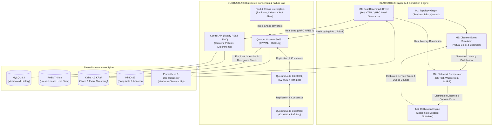

# BLACKBOX-X & QUORUM LAB — Dual-Engine Integration Guide

## 1. System Architecture: The Dual-Engine Philosophy

**BLACKBOX-X** and **QUORUM LAB** are designed as high-precision companion platforms that together solve the complete distributed systems evaluation puzzle:

```
┌─────────────────────────────────────────────────────────────────────────────┐
│                             THE SISTER PLATFORMS                            │
├──────────────────────────────────────┬──────────────────────────────────────┤
│              BLACKBOX-X              │              QUORUM LAB              │
│       Capacity & Performance         │       Consistency & Correctness      │
├──────────────────────────────────────┼──────────────────────────────────────┤
│ • "How does the system perform?"     │ • "What does it actually guarantee?" │
│ • Discrete-event queueing simulation │ • 5-axis decoupled consistency model │
│ • Microsecond virtual event calendar │ • Vector clocks & CRDT merges        │
│ • Little's Law & bottleneck search   │ • Raft consensus & leader leases     │
│ • Two-Sample KS & Wasserstein test   │ • Anti-entropy Merkle tree repair    │
│ • Closed-loop model calibration      │ • Deterministic network chaos        │
└──────────────────────────────────────┴──────────────────────────────────────┘
```



---

## 2. Shared Infrastructure Port Map

Both repositories share an identical enterprise tech spine (Node.js 24 LTS, TypeScript, Fastify, MySQL 8.4, Redis, Kafka, MinIO, Prometheus, Vitest). When running both systems concurrently, the port map is collision-free:

| Component | Port | Protocol | Purpose |
| :--- | :--- | :--- | :--- |
| **MySQL 8.4** | `3308` (container) / `3306` (native) | TCP | Shared relational store (isolated databases `blackbox` and `quorum_lab`) |
| **Redis** | `6380` (container) / `6379` (native) | TCP | Lease coordination, epoch authority, live worker locks |
| **Kafka KRaft** | `9092` / `9094` | TCP | Event streaming (`quorum.replication.events`, `bbx.simulation.traces`) |
| **MinIO S3** | `9000` (API), `9001` (Console) | HTTP | Object storage buckets: `blackbox-artifacts`, `quorum-snapshots` |
| **Prometheus** | `9090` | HTTP | Metrics scraping from both platforms |
| **QUORUM LAB Control API** | `3000` | HTTP / REST | Project, cluster, policy, experiment management |
| **BLACKBOX-X Control API** | `3001` | HTTP / REST | Topology, simulation, calibration API |
| **QUORUM Node A** | `50051` | gRPC | Quorum node 0 (NodeService, RaftService, FaultControlService) |
| **QUORUM Node B** | `50052` | gRPC | Quorum node 1 |
| **QUORUM Node C** | `50053` | gRPC | Quorum node 2 |

---

## 3. The 4 Closed-Loop Integration Touchpoints

### Touchpoint 1: Topology Modeling (BLACKBOX-X represents QUORUM LAB)
In BLACKBOX-X (`packages/domain`), model the QUORUM LAB cluster as a multi-node topology:
```json
{
  "topologyName": "quorum-lab-3node-cluster",
  "nodes": [
    { "id": "gateway", "kind": "SERVICE", "tier": "EDGE", "capacityRps": 20000 },
    { "id": "node-a", "kind": "DATABASE", "tier": "STORAGE", "capacityRps": 8000 },
    { "id": "node-b", "kind": "DATABASE", "tier": "STORAGE", "capacityRps": 8000 },
    { "id": "node-c", "kind": "DATABASE", "tier": "STORAGE", "capacityRps": 8000 }
  ],
  "edges": [
    { "source": "gateway", "target": "node-a", "kind": "SYNC_GRPC", "timeoutMs": 1000 },
    { "source": "node-a", "target": "node-b", "kind": "SYNC_GRPC", "latencyUs": 1500 },
    { "source": "node-a", "target": "node-c", "kind": "SYNC_GRPC", "latencyUs": 1500 }
  ]
}
```

### Touchpoint 2: Load Injection (BLACKBOX-X benchmarks QUORUM LAB)
BLACKBOX-X's real benchmark harness (`@blackbox-x/comparison`) targets QUORUM LAB nodes using open-loop workloads with configurable keyspace distributions (Zipfian $\theta=0.99$ or Uniform):
- BLACKBOX-X fires concurrent requests ($100 \rightarrow 10,000$ RPS) against `node-a:50051`.
- QUORUM LAB replicates mutations across `node-b` and `node-c` under the configured consistency policy (e.g. `RAFT` or `LEADERLESS Quorum W=2, R=2`).

### Touchpoint 3: Co-Orchestrated Chaos Timelines
Simultaneous evaluation of **Queueing Degradation** and **Consistency Violations**:
1. BLACKBOX-X ramps traffic to near-saturation (e.g. 5,000 RPS).
2. QUORUM LAB's timeline runner (`@quorum-lab/timeline`) schedules a network partition cutting `node-a` at $t=15\text{s}$.
3. Observations:
   - **BLACKBOX-X measures**: Queue backlog, connection pooling saturation, p99 latency spike, Little's Law divergence.
   - **QUORUM LAB measures**: Election term increment (Raft) or lease expiration and split-brain fencing (`STATUS_CODE_FENCED`), replica divergence, and subsequent Merkle repair convergence time.

### Touchpoint 4: Closed-Loop Calibration (Simulation Validation)
1. **Simulate**: BLACKBOX-X simulates the predicted p50/p95/p99 latency for $W=2, R=2$ with 15ms simulated link delay.
2. **Measure**: BLACKBOX-X benchmark driver runs against QUORUM LAB with 15ms injected delay via `@quorum-lab/fault-model`.
3. **Compare**: The Statistical Comparator (`@blackbox-x/comparison`) computes the Two-Sample Kolmogorov-Smirnov test statistic ($D_{KS}$) and Wasserstein distance between the simulated curve and the real curve.
4. **Calibrate**: BLACKBOX-X's coordinate descent optimizer adjusts service distribution parameters ($\mu, \sigma$) until $D_{KS} < 0.05$ (certified predictive accuracy).

---

## 4. Operator Runbook: Running the Platforms Together

### Phase 1: Launch Shared Infrastructure
In `c:\MSC\Main project\BLACKBOX-X`:
```bash
# Start MySQL, Redis, Kafka, MinIO, Prometheus
docker compose -f infrastructure/compose/docker-compose.yml --profile full up -d
```

### Phase 2: Launch QUORUM LAB Cluster
In `c:\MSC\Main project\QUORUM LAB`:
```bash
# Build monorepo packages
npx pnpm build

# Start 3-node cluster with Raft or Quorum replication
# Terminal 1: Node A
QUORUM_NODE_ID=node-a QUORUM_GRPC_PORT=50051 QUORUM_CLUSTER_MEMBERS=node-a,node-b,node-c npx tsx apps/quorum-node/src/main.ts

# Terminal 2: Node B
QUORUM_NODE_ID=node-b QUORUM_GRPC_PORT=50052 QUORUM_CLUSTER_MEMBERS=node-a,node-b,node-c npx tsx apps/quorum-node/src/main.ts

# Terminal 3: Node C
QUORUM_NODE_ID=node-c QUORUM_GRPC_PORT=50053 QUORUM_CLUSTER_MEMBERS=node-a,node-b,node-c npx tsx apps/quorum-node/src/main.ts

# Terminal 4: Control API
npx tsx apps/control-api/src/main.ts
```

### Phase 3: Launch BLACKBOX-X & Execute End-to-End Campaign
In `c:\MSC\Main project\BLACKBOX-X`:
```bash
# Execute simulation against the modeled Quorum Lab cluster
npx tsx apps/api/src/main.ts

# Run the real comparison gate targeting Quorum Lab
npx vitest run tests/gates/m4.gate.test.ts
```

### Phase 4: Inspect Unified Insights
- **BLACKBOX-X Dashboard (`http://localhost:3001`)**: View capacity limits, bottleneck ranking, queue wait-times, and KS goodness-of-fit.
- **QUORUM LAB Control Plane (`http://localhost:3000`)**: View replica version frontiers, vector clock states, repair counts, and linearizability audit results.
